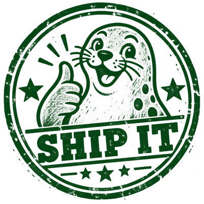
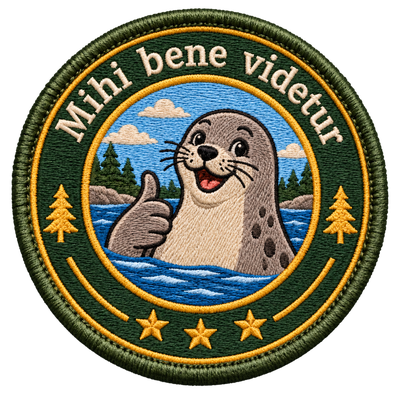
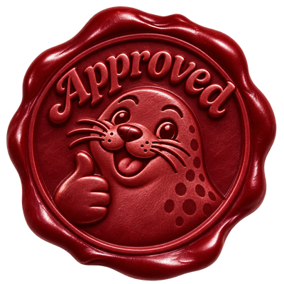
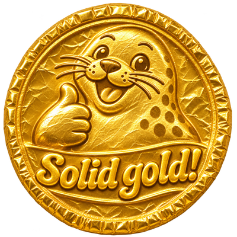
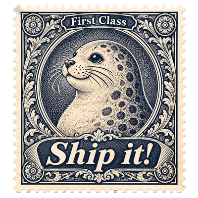
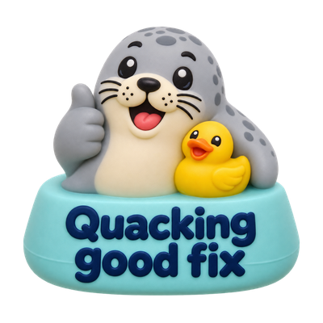

# public-assets
Reusable images, badges, and other public assets for linking in comments, documentation, and projects.

## Seals

Original-resolution PNGs are in `images/seals/`. Smaller, transparent PNG copies are in `images/seals/small/`, resized proportionally to 400 pixels wide for display at 200 pixels in comments.

Click a preview to view the full-size original.

| Seal | Preview |
| --- | --- |
| Seal of approval | [](images/seals/seal-of-approval.png) |
| Ship it | [](images/seals/ship-it-seal.png) |
| Merge | [](images/seals/merge-seal.png) |
| Graduation | [](images/seals/graduation-seal.png) |
| Scout patch | [](images/seals/scout-patch-seal.png) |
| Nicely done! | [](images/seals/nicely-done-seal.png) |
| Wax seal | [](images/seals/wax-seal.png) |
| Gold coin | [](images/seals/gold-coin-seal.png) |
| Victorian postage stamp | [](images/seals/postage-stamp-seal.png) |
| Ceramic tile | [](images/seals/ceramic-tile-seal.png) |
| Arcade token | [](images/seals/arcade-token-seal.png) |
| Hacker badge | [](images/seals/hacker-badge-seal.png) |
| Mission Control | [](images/seals/mission-control-seal.png) |
| Chef’s Kiss | [](images/seals/chefs-kiss-seal.png) |
| Rubber Duck Debugging | [](images/seals/rubber-duck-debugging-seal.png) |
| Magician | [](images/seals/magician-seal.png) |

### Using a seal

Use this in a GitHub comment or saved reply:

```html

```

Swap `seal-of-approval.png` for any filename in the gallery above, such as `nicely-done-seal.png`, `postage-stamp-seal.png`, or `hacker-badge-seal.png`. Keep `/small/` in the URL for the comment-sized version.
